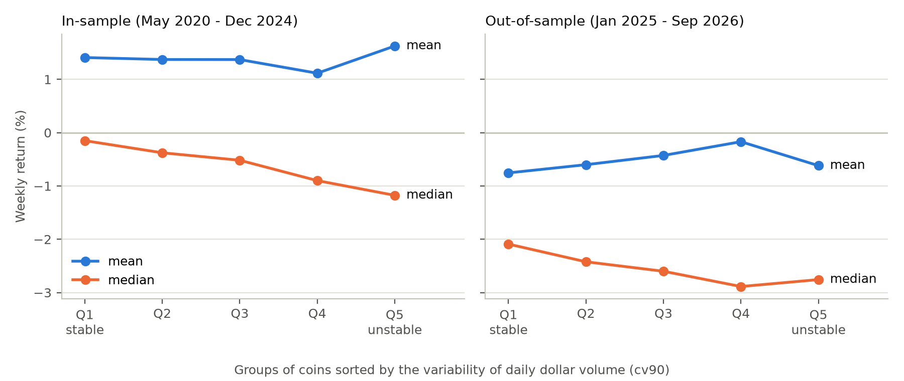

# Trading-volume variability and crypto returns

Does unstable trading activity predict lower returns on Binance USDT-margined perpetual futures? This project rebuilds a practitioner signal using independently collected data, tests its sensitivity to volume and listing age, and compares it with a daily-volume coefficient of variation inspired by Chordia, Subrahmanyam and Anshuman (2001). The initial analysis plan was committed before the analysis code.

**The daily-volume measure does not pass the project's average-return tests.** The original signal is strongly related to dollar volume, and its in-sample return spread shrinks when recent listings are excluded. Its out-of-sample spread is close to zero. An exploratory distribution check finds a recurring pattern: the highest-CV quintile has lower median returns and more coin-weeks above +50% than the lowest-CV quintile in both periods.

[Research plan](proposal.md) · [Supplementary analysis and data notes](docs/research_notes.md) · [Reproduce](#reproduce)

## Results

The study uses 679 single-coin contract symbols, including delisted contracts. Portfolios are formed weekly.

| Sample | Formation dates | Weeks | Median contracts with a valid daily-volume signal |
|---|---|---:|---:|
| In-sample | May 2020–December 2024 | 242 | ≈136 |
| Out-of-sample | January 2025–September 2026 | 90 | 452 |

Two signals are compared:

- **Original signal (`naive`):** standard deviation of hourly dollar volume over 63 observations, retaining the practitioner specification.
- **Daily-volume CV (`cv90`):** `log(std / mean)` of daily dollar volume over 90 observations. Each daily observation must contain 24 hours of data.

Dollar volume means quote volume in USDT. The CV measures variability relative to average volume. Multiplying a coin's volume series by a positive constant leaves its CV unchanged; volume remains a regression control.

For each signal, Q1 contains the lowest values and Q5 the highest. Return spreads are **Q5 minus Q1**, using equal-weighted portfolios; the proposed trade goes in the opposite direction, long Q1 and short Q5.

Returns include funding and are reported in **% per week**. Parentheses contain Newey–West t-statistics with four lags. Rank IC is the weekly cross-sectional rank correlation between the signal and the following week's return, averaged over time. Regression coefficients are per standard deviation of the processed signal.

### The original signal weakens under volume controls and out of sample

| `naive` | In-sample | Out-of-sample |
|---|---:|---:|
| Rank IC | −0.072 (−7.15) | −0.062 (−6.85) |
| Q5−Q1 return spread | −1.26% (−2.48) | −0.02% (−0.04) |
| Spread, restricted to contracts with valid `cv90` | −0.68% (−1.60) | −0.40% (−1.18) |
| Long Q1, short Q5, after 10 bp costs per side | +1.10% (2.18) | −0.14% (−0.28) |

The signal is strongly related to dollar volume: their average weekly rank correlation is 0.78 in-sample. In Fama–MacBeth regressions, the coefficient on the log of the signal is −0.36% (t = −2.33) alone and −0.18% (t = −0.54) after adding log volume and its square. This log specification was added after inspecting the raw-signal regression.

Excluding contracts listed less than 30 days ago reduces the original quintile spread to −0.78% (t = −1.87). These checks show sensitivity to volume and recent listings; they do not separate size from liquidity.

The naive tests otherwise include contracts with short histories. The restricted row makes the comparison with `cv90` on the same eligible universe. [Full diagnosis](docs/research_notes.md#diagnosis-of-the-original-signal).

### The daily-volume CV has a negative rank IC, but no significant mean-return spread

| `cv90` | In-sample | Out-of-sample |
|---|---:|---:|
| Rank IC | −0.043 (−3.33) | −0.039 (−3.27) |
| Q5−Q1 return spread | +0.22% (0.51) | +0.14% (0.42) |
| Fama–MacBeth coefficient with all controls | +0.01% (0.08) | −0.09% (−0.65) |
| Long Q1, short Q5, after 10 bp costs per side | −0.28% (−0.66) | −0.19% (−0.59) |

The proposal required a negative spread and a negative controlled regression coefficient, both with |t| > 2 in-sample and the same sign out-of-sample. Neither condition is met.

The estimates are imprecise: the spread's 95% confidence interval is [−0.62%, +1.05%] in-sample and [−0.49%, +0.77%] out-of-sample. Economically sizable effects in either direction remain possible.

Changing the window, excluding the bottom 20% by dollar volume, or using a one-day holding period yields no significant spread or controlled coefficient in-sample. Annual spreads change sign. [Robustness results](docs/research_notes.md#robustness-checks).

### Lower medians and more extreme positive returns — exploratory

The rank and mean results prompted a closer look at the return distribution. The median and positive-tail checks below were added after the in-sample analysis and recorded before the first committed out-of-sample results.



*Each point averages a quintile's weekly cross-sectional mean or median return over time. Q1 has the lowest `cv90`; Q5 the highest.*

| Distribution check | In-sample | Out-of-sample |
|---|---:|---:|
| Average weekly median spread, Q5−Q1 | −1.03% (−2.73) | −0.67% (−2.76) |
| Share of coin-weeks above +50%, Q1 → Q5 | 0.92% → 1.98% | 0.78% → 1.92% |

Both patterns recur in the later sample. The median spread is weak evidence under the project's reporting thresholds; the tail frequencies pool coin-weeks and have no significance test. They are consistent with large positive returns offsetting lower medians, but their contribution to the mean spread has not been measured.

Return volatility remains a competing explanation. A subsequent check finds more returns below −33⅓% in Q5 than Q1 out-of-sample, and sorting first by past volatility reduces the median spread. The reduction itself is not significant. [Volatility checks](docs/research_notes.md#return-volatility).

### Buy and sell measures offer little separation

Computing `cv90` separately from taker-buy and taker-sell dollar volume produces almost identical rankings: correlations are 0.993 in-sample and 0.998 out-of-sample. In a joint controlled regression, the buy-minus-sell coefficient difference is +1.69% (t = 0.63) and −2.03% (t = −0.43), respectively.

This test was intended to investigate a buying-pressure interpretation of overpricing. The two signals are so closely related that the regression cannot reliably separate their effects. Taker buys also include short covering and liquidations. The test therefore provides little evidence about the mechanism.

Full test output: [in-sample](results/in_sample_tests.txt) · [out-of-sample](results/out_of_sample_tests.txt).

## Data and method

**Data.** Hourly klines and funding rates come from the [Binance public archive](https://data.binance.vision/), covering January 2020–September 2026. Of 900 symbols in the collected data, 679 enter the single-coin universe; [`results/universe.csv`](results/universe.csv) records every inclusion and exclusion. Cleaning removes frozen records outside each symbol's traded history and zero-volume days. Gaps longer than seven days start a new listing.

**Window and schedule.** The CV uses 90 daily observations to study variability over several months while retaining contracts with relatively short histories. The proposal specified this window alongside 60- and 120-day checks. Weekly formation was intended to balance position updates and turnover; Monday sets a consistent UTC week boundary. [Design rationale](docs/research_notes.md#window-and-trading-schedule).

**Timing.** Signals use price and volume data through Sunday; the funding control includes Monday's 00:00 UTC settlement. Entry is at Monday's 01:00 open, leaving an hour for calculation and order placement. Exit is at the following Monday's 01:00 open.

**Returns.** Funding is charged on position value at each settlement, with that hour's kline open used as a mark-price proxy. Delisting exits use the last available closing price.

**Controls.** Log average daily dollar volume and its square, log listing age, 30-day momentum skipping the last day, the last day's return, 30-day return volatility, and average daily funding over seven days. Regression inputs are clipped at the weekly 1st and 99th percentiles and standardized; the squared-volume term is formed afterwards. Rank ICs and portfolio sorts use unprocessed signals, and returns are not clipped. [Exact windows and implementation](docs/research_notes.md#signal-and-estimation-details).

**Inference.** Tests include rank ICs, quintile portfolios, Fama–MacBeth regressions and 3×3 conditional sorts. Results with |t| > 3 are reported as strong evidence and 2 < |t| ≤ 3 as weak evidence. These thresholds reflect the multiple-testing concern in Harvey, Liu and Zhu (2016); they are a reporting convention, not a formal adjustment.

**Research sequence.** The plan tagged `proposal-v1` precedes the analysis code and results in the commit history. The distribution hypothesis followed the in-sample findings. Volatility checks and a funding-calculation correction followed the first out-of-sample run; all reported returns use the correction. The later sample is consequently no longer an untouched test set. [Changes and commit history](docs/research_notes.md#research-sequence).

## Limitations and next steps

- **Size and liquidity remain entangled.** Dollar volume is a proxy because market-cap data are unavailable. The evidence covers one exchange and perpetual futures, rather than the equities studied by Chordia et al.
- **The signal comparison changes several things at once.** Normalization, frequency and window length all differ. A useful next test would vary these separately on a common sample; the current hourly-profile analysis does not isolate a horizon effect.
- **Missing data affect returns and selection.** Archive gaps omit some funding payments and extend observation-based windows. In the week of 21 February 2022, 48 contracts without an exit price are excluded before sorting. This conditions inclusion on subsequent data availability and may bias that week's results. Other missing funding records are treated as zero. [Affected dates and counts](docs/research_notes.md#data-gaps-and-return-construction).
- **Execution is approximate.** Fixed costs of 5–10 bp per side may understate small-contract trading costs. Turnover ignores weight drift, and using a last observed price at delisting does not establish that an exit was executable.
- **Text could help test the mechanism.** Applying NLP to news and social media could produce proxies for investor attention and disagreement, providing another way to test the overpricing explanation.

## Reproduce

Use Python 3.11 or later and the versions in [`requirements.txt`](requirements.txt). The raw data are not committed. From the repository root:

```bash
python -m pip install -r requirements.txt
python src/download.py
```

Check that the download reports `fail: 0` and `data/raw/failed.txt` is empty. Keep the committed universe file, then build the panel and signals:

```bash
python src/build_panel.py
python src/measures.py
```

With `PERIOD = "in"` in `src/helpers.py`, run:

```bash
python src/test.py > results/in_sample_tests.txt
python src/diagnosis.py > results/in_sample_diagnosis.txt
python src/robustness.py > results/in_sample_robustness.txt
python src/explore.py > results/in_sample_explore.txt
```

Set `PERIOD = "out"` and run:

```bash
python src/test.py > results/out_of_sample_tests.txt
python src/explore.py > results/out_of_sample_explore.txt
```

Restore `PERIOD = "in"`, then generate the figures:

```bash
python src/figure.py
python src/hourly_profile.py > results/in_sample_hourly_profile.txt
```

The panel and signals cover both periods, so switching samples does not require rebuilding them. These commands replace the saved result files and figures. Three-group sorts can differ slightly across pandas versions. The archive can also change; [reproduction notes](docs/research_notes.md#reproduction-notes) explain the outputs and universe rebuild.

## References

- Chordia, T., A. Subrahmanyam and V. R. Anshuman (2001). [Trading activity and expected stock returns](https://doi.org/10.1016/S0304-405X(00)00080-5). *Journal of Financial Economics* 59, 3–32.
- Fama, E. F. and J. D. MacBeth (1973). Risk, return, and equilibrium: Empirical tests. *Journal of Political Economy* 81, 607–636.
- Harvey, C. R., Y. Liu and H. Zhu (2016). [… and the cross-section of expected returns](https://doi.org/10.1093/rfs/hhv059). *Review of Financial Studies* 29, 5–68.
- Newey, W. K. and K. D. West (1987). A simple, positive semi-definite, heteroskedasticity and autocorrelation consistent covariance matrix. *Econometrica* 55, 703–708.

Related literature and the motivation for the controls and mechanism test are in the [supplementary notes](docs/research_notes.md#literature-and-motivation).
