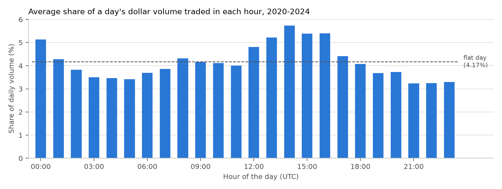

# Supplementary analysis and data notes

[Back to the README](../README.md)

These notes expand on the README's diagnostics, methods and research history.

Returns are percentages per week unless stated otherwise; parentheses contain Newey–West t-statistics with four lags. Signal correlations are time averages of weekly cross-sectional rank correlations.

## Diagnosis of the original signal

### Volume and listing age

In-sample, the naive signal's rank correlation with dollar volume is 0.777 across all eligible contracts and 0.781 among those with valid `cv90`. The corresponding correlation for `cv90` is −0.045, much lower in magnitude. This does not establish independence from size or liquidity.

| In-sample diagnosis | Estimate | t-statistic |
|---|---:|---:|
| Naive quintile spread, all eligible contracts | −1.26% | −2.48 |
| Naive spread after sorting first by volume (3×3) | −0.38% | −1.23 |
| Naive quintile spread, excluding listings younger than 30 days | −0.78% | −1.87 |
| Naive spread within the youngest age third (3×3) | −1.53% | −3.41 |
| Regression coefficient on log naive, alone | −0.36% | −2.33 |
| Same, controlling for log volume and its square | −0.18% | −0.54 |
| Same, controlling for log listing age | −0.25% | −2.14 |

The 3×3 sorts use signal thirds within volume or age thirds. Their spreads are not directly comparable with the quintile spreads because the groups differ.

Regression coefficients are per standard deviation of the processed signal. The log specification was added after the raw naive signal gave an insignificant coefficient of −0.08% (t = −0.74). Both specifications remain in the result files.

Contracts younger than 30 days account for 3.7% of observations overall, 5.6% of the highest naive quintile and 3.0% of the lowest. Among the three age groups, only the youngest has a spread with |t| > 2. Excluding recent listings weakens the negative spread. In the regression, however, the log-naive coefficient remains negative with |t| > 2 after controlling for listing age.

Sources: [main tests](../results/in_sample_tests.txt), [diagnosis](../results/in_sample_diagnosis.txt).

### Horizon and the hourly profile

The naive signal and `cv90` have a rank correlation of −0.061 in-sample. Normalization, sampling frequency and window length all change together, so this comparison cannot isolate the effect of horizon.



*The daily profile averages hourly volume shares within each coin, then across 390 coins with full in-sample trading days. The dashed line is 1/24 of daily volume per hour.*

The average profile assigns 5.74% of daily volume to 14:00 UTC and 3.24% to 21:00, a ratio of 1.77.

The CV across the profile's 24 hourly shares is 0.179. For comparison, the median rolling 63-hour CV is calculated for each coin; the median of those coin-level values is 0.696. This comparison was added after the first out-of-sample run.

Averaging profiles can smooth individual patterns, so these numbers do not estimate the proportion of hourly variability attributable to time of day.

Sources: [output](../results/in_sample_hourly_profile.txt), [implementation](../src/hourly_profile.py).

## Robustness checks

The following checks use the in-sample period. The 60-day signal is evaluated on the `cv90`-eligible sample. The 120-day check additionally requires valid `cv120` and starts on 15 June 2020, the first week with at least 20 eligible contracts.

| Variant | Rank IC | Q5−Q1 return spread | Controlled Fama–MacBeth coefficient |
|---|---:|---:|---:|
| Main: 90-day window | −0.043 (−3.33) | +0.22% (0.51) | +0.01% (0.08) |
| 60-day window | −0.045 (−3.75) | +0.36% (0.78) | −0.02% (−0.12) |
| 120-day window | −0.044 (−3.96) | +0.36% (0.88) | +0.09% (0.43) |
| Excluding the bottom 20% by dollar volume | −0.042 (−3.56) | +0.57% (1.21) | +0.22% (1.09) |
| One-day holding period: returns per day | −0.049 (−3.79) | −0.18% (−1.15) | −0.08% (−1.80) |

The rank IC is negative in each variant and in each year. Annual mean-return spreads change sign: +1.63% (t = 1.34) in 2021 and −0.73% (t = −2.24) in 2022. Only 2022's annual spread reaches |t| > 2.

The one-day holding check retains Monday formations and measures returns from Monday 01:00 to Tuesday 01:00 UTC. It tests a shorter return horizon; it does not simulate daily rebalancing or compare alternative formation days.

Source: [full robustness output, including each year](../results/in_sample_robustness.txt).

## Return volatility

These checks were added after the first out-of-sample run. `cv90` is positively related to 30-day return volatility: rank correlations are 0.36 in-sample and 0.28 out-of-sample. In a lognormal price model, increasing log-return variance while holding the arithmetic mean fixed lowers the median. Volatility could therefore contribute to the median pattern.

The share of coin-weeks below −33⅓% is 1.29% in Q1 and 1.32% in Q5 in-sample; out-of-sample it is 0.35% and 1.68%. A 33⅓% fall reverses a 50% price rise. These frequencies are descriptive and have no formal significance test.

To compare contracts with similar past volatility, the analysis first sorts into volatility thirds, then `cv90` thirds. The unconditional comparison also uses thirds and the same eligible observations.

| Median return spread, high minus low `cv90` | In-sample | Out-of-sample |
|---|---:|---:|
| Unconditional thirds | −0.71% (−3.06) | −0.53% (−2.38) |
| Average within volatility thirds | −0.53% (−2.00) | −0.41% (−1.65) |
| Reduction in the negative spread | +0.18% (1.03) | +0.12% (0.91) |

Neither reduction is statistically significant. Groups based on past volatility also do not fully control for volatility during the holding week, so this check cannot determine how much volatility explains the median pattern.

Sources: [in-sample exploration](../results/in_sample_explore.txt), [out-of-sample exploration](../results/out_of_sample_explore.txt).

## Window and trading schedule

The original signal retains its 63-hour window. The CV uses 90 full daily observations to study variability over several months while retaining contracts with relatively short histories. This requirement also keeps newly listed contracts out of the CV portfolio tests. Ninety is a practical choice; the proposal specified 60- and 120-day alternatives, reported in the [robustness checks](#robustness-checks).

Weekly portfolio sorts have a precedent in [Liu, Tsyvinski and Wu's cryptocurrency study](https://economics.yale.edu/sites/default/files/2022-10/LiuTsyvinskiWu2019%20COMMON%20RISK%20FACTORS.pdf). The later sample spans about 21 months and supplies 90 weekly return observations. Weekly rebalancing was chosen to balance position updates and turnover for a measure whose successive 90-day windows overlap heavily.

Monday defines a consistent UTC week after the complete Sunday data. Entry at 01:00 leaves a one-hour buffer for calculation and order placement.

## Signal and estimation details

### Signals and controls

- The naive measure uses the latest 63 available hourly records with `min_periods=1`. Undefined standard deviations, including a one-observation history, become zero. Missing hours are not filled.
- Daily CVs use the latest 60, 90 or 120 daily records within each listing. Each record in a valid window must contain 24 hours; incomplete days invalidate the window. Entirely absent days do not occupy a row, so these windows may span more calendar days than their labels suggest.

| Control | Calculation |
|---|---|
| Dollar volume | Log of average daily dollar volume over the latest 90 records. Only full days contribute; shorter histories are allowed. |
| Listing age | Log of days from the listing's first daily record to portfolio formation. |
| Momentum | Previous record's close divided by the close 31 daily records back, minus one. |
| Reversal | Latest daily return. |
| Return volatility | Standard deviation of the latest 30 daily returns. |
| Funding | Average of the latest seven daily funding sums. Each day's interval runs from 01:00 UTC to 01:00 the following day. |

Missing daily rows can extend these observation-based windows beyond the stated number of calendar days.

### Estimation and sample

Each regression input is clipped at the weekly 1st and 99th percentiles and standardized within its test sample. The squared-volume term is the square of standardized log volume. Regressions include an intercept and drop observations missing any required variable.

Sorts drop observations missing the signal or forward return; conditional sorts also require the conditioning variable. Ties are broken by row order before allocating equal-count groups. This missing-return filter explains the exclusions described below.

The analysis starts at the first week with at least 20 contracts having valid `cv90`: 18 May 2020. The last in-sample formation date is 30 December 2024. Out-of-sample formation dates run from 6 January 2025 to 21 September 2026. The split is by formation date, so the final in-sample holding week extends into January 2025.

Spread confidence intervals use the mean ± 1.96 times its Newey–West standard error. The median statistic averages weekly differences between cross-sectional group medians; it is a distribution statistic rather than a portfolio return. Tail frequencies instead pool all eligible coin-weeks.

Sources: [panel construction](../src/build_panel.py), [signals and returns](../src/measures.py), [test helpers](../src/helpers.py).

## Data gaps and return construction

The universe contains 679 retained single-coin symbols and excludes 212 stock, ETF, commodity, currency and pre-IPO symbols, 6 indices, 2 gold tokens and 1 stablecoin. Classification combines exchange metadata with manual exceptions; [the universe file](../results/universe.csv) records the decisions. Twelve symbols have separate listings after gaps longer than seven days.

Missing hourly data affect about 50 contracts on 26–28 February and 1–2 April 2022:

- The April gaps cause funding omissions in 49 retained coin-weeks, in the week beginning 28 March 2022.
- About 1% of valid weekly `cv90` values span more than 90 calendar days, up to 95.
- In the week beginning 21 February 2022, 48 contracts lack a weekly exit price and are excluded before sorting; 44 have valid `cv90`. The analysis has not quantified sensitivity to this selection.
- Separately, missing funding records for parts of ICPUSDT, TLMUSDT and BNXUSDT are treated as zero and affect 146 coin-weeks.

Funding is deducted from price returns as the sum of funding rate × settlement-hour open, divided by entry price. The hourly open is a proxy for mark price.

Settlements without a price contribute nothing to this sum, including those after the last traded hour. Funding assigned to an entirely absent daily row is also lost.

If a listing ends before the scheduled exit, its final available daily close supplies the exit price. These price proxies do not establish that trades were executable at the assumed prices.

## Research sequence

The commit history records when plans, results and changes entered the repository; it is not an independent record of when data were first viewed.

| Stage | Repository record |
|---|---|
| Original analysis plan | `proposal-v1` (`1288170`), before analysis code and results |
| In-sample diagnosis and robustness | `a01e2c7`, `1c2c206` |
| Exploratory median and +50% tail criteria | Recorded in `proposal.md` by `a6b9674`, after in-sample analysis |
| First committed out-of-sample results | `d429afb` |
| Volatility follow-up and helper correction | `06dc3a3`, `f4ca261` |
| Hourly-profile figure and comparison | `1dad4fc` |
| Funding correction and rerun of results | `645aeb1` |

The exploratory criteria were a negative median spread with |t| > 2 and a higher +50% frequency in Q5. Both hold in the reported out-of-sample results. The frequency condition has no significance threshold.

The funding correction replaced a simple sum of rates with charges based on position value at settlement. The [proposal's deviations](../proposal.md#deviations-from-the-pre-registration) also record the sample-start rule and the addition of log-naive regressions.

## Reproduction notes

[`build_panel.py`](../src/build_panel.py) writes `data/clean/daily_panel.parquet`; [`measures.py`](../src/measures.py) writes `data/clean/weekly.parquet`. Both cover the full period.

[`figure.py`](../src/figure.py) loads both samples itself and writes `results/figure1_mean_vs_median.png`. [`hourly_profile.py`](../src/hourly_profile.py) reads raw hourly data, uses the in-sample period and writes `results/figure2_hourly_profile.png`.

To rebuild the universe, first build the daily panel, then run:

```bash
python src/get_exchange_info.py
python src/universe.py
python src/measures.py
```

This replaces `results/universe.csv` using current exchange metadata and the code's manual exceptions. Retain the committed file to preserve the original classification. Binance's archive files and directory listings may still change, so a fresh download is not a frozen data snapshot.

## Literature and motivation

Chordia, Subrahmanyam and Anshuman (2001) report lower subsequent stock returns for more variable trading activity, measuring variability with the coefficient of variation. This project adapts that question to daily crypto volume; it does not directly replicate their stock-market design.

Proposed explanations include investors timing trades to favorable liquidity conditions (Pereira and Zhang, 2010), a hedge against aggregate volatility risk (Barinov, 2015), and temporary overpricing under disagreement and short-sale constraints (George and Hwang, 2013, building on Miller, 1977).

The buy–sell test assumes that taker direction provides information about traders' beliefs. Short covering and liquidations weaken that interpretation.

Liu, Tsyvinski and Wu (2022) motivate attention to size and momentum in cryptocurrency returns. Using dollar volume as a size proxy here is a data limitation, not a claim that volume and market capitalization are equivalent.

- Barinov, A. (2015). [Why does higher variability of trading activity predict lower expected returns?](https://doi.org/10.1016/j.jbankfin.2015.05.014) *Journal of Banking & Finance* 58, 457–470. [Author manuscript](https://faculty.ucr.edu/~abarinov/Turnover%20Variability%20%28JBF%20R3%29.pdf).
- George, T. J. and C.-Y. Hwang (2013). [Analyst coverage and two volatility puzzles in the cross section of returns](https://www.bauer.uh.edu/tgeorge/papers/ACOV.pdf). Working paper.
- Liu, Y., A. Tsyvinski and X. Wu (2022). [Common risk factors in cryptocurrency](https://doi.org/10.1111/jofi.13119). *Journal of Finance* 77, 1133–1177.
- Miller, E. M. (1977). Risk, uncertainty, and divergence of opinion. *Journal of Finance* 32, 1151–1168.
- Pereira, J. P. and H. H. Zhang (2010). [Stock returns and the volatility of liquidity](https://doi.org/10.1017/S0022109010000323). *Journal of Financial and Quantitative Analysis* 45, 1077–1110.
